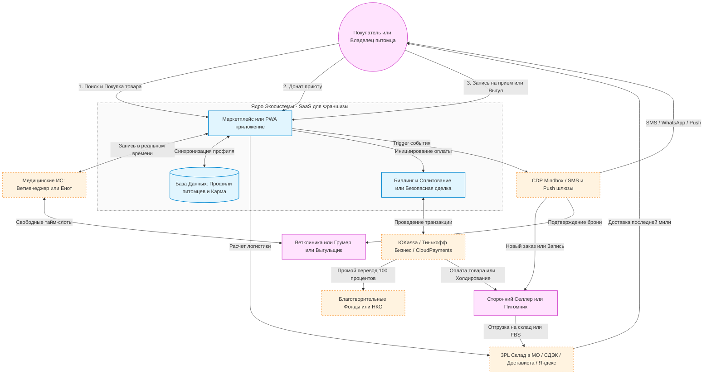
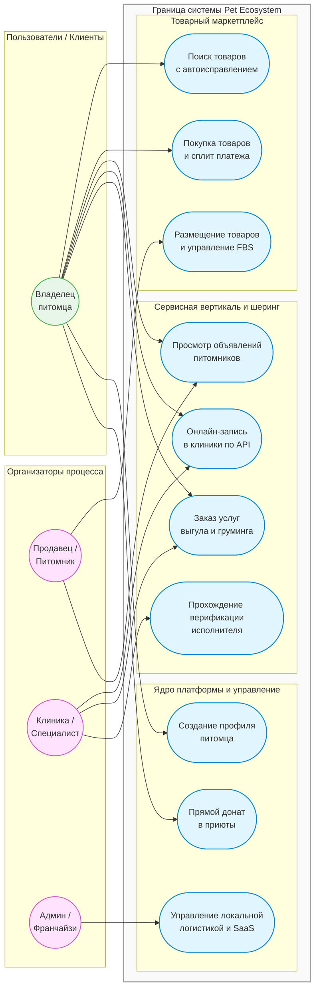

# Pet Ecosystem Platform

Платформа представляет собой распределенную e-commerce и сервисную экосистему для владельцев питомцев, питомников, ветеринарных клиник и специалистов по уходу. Архитектура платформы спроектирована как SaaS-решение, готовое к последующей упаковке во франшизу и экспансии в новые регионы.

Проект объединяет товарный маркетплейс, агрегатор проверенных питомников, онлайн-запись в клиники и шеринг-экономику (выгул, груминг) в единое PWA-приложение, решая проблему разрозненности зооуслуг.

---

## Навигация по документации

* [Техническая архитектура системы](#техническая-архитектура-системы)
* [Диаграмма прецедентов (Use Case)](#диаграмма-прецедентов-use-case)
* [Дорожная карта разработки (24 месяца)](#дорожная-карта-разработки-24-месяца)
* [Спецификация ключевых модулей](#спецификация-ключевых-моделей)
* [Юридические и финансовые ограничения](#юридические-и-финансовые-ограничения)
* [Логистическая инфраструктура](#логистическая-инфраструктура)
* [Первоочередной план действий](#первоочередной-план-действий)

---

### Технологический стек ядра:
* **Frontend:** PWA-приложение на **Svelte 5** (высокая скорость работы, легковесный рантайм, реактивность на рунах).
* **Backend:** Микросервисы на **Bun + Elysia** (максимальная производительность, встроенный TypeScript, минимальный cold start).
* **Поиск:** Умный полнотекстовый движок **Meilisearch** (мгновенный поиск out-of-the-box, низкое потребление ресурсов).

## Техническая архитектура системы

Платформа является распределенным облачным приложением, взаимодействующим с внешними логистическими, финансовыми и медицинскими сервисами по API.

### Схема взаимодействия компонентов (High-Level Architecture)

---

## Диаграмма прецедентов (Use Case)

Диаграмма описывает роли участников системы, разделенных на конечных пользователей (клиентов) и организаторов процесса (бизнес-партнеров, администраторов и франчайзи), а также сценарии их взаимодействия с платформой.

---

## Дорожная карта разработки (24 месяца)

| Этап | Временной отрезок | Основной фокус | Ключевой функционал |
| :--- | :--- | :--- | :--- |
| **Этап 1** | 0 – 3 месяца | Запуск e-commerce ядра и логистики в ЦФО | MVP, поиск Elasticsearch, SMS-авторизация, интеграция с 3PL-складами. |
| **Этап 2** | 3 – 6 месяцев | Запуск модели Маркетплейса и Донатов | Кабинет селлера, виджет благотворительности, запуск агрегатора питомников. |
| **Этап 3** | 6 – 12 месяцев | Сервисная вертикаль Ветклиники | Интеграция по API с МИС (Ветменеджер, Енот) для бронирования тайм-слотов. |
| **Этап 4** | 12 – 18 месяцев | Шеринг-экономика (Выгул, Груминг) | Выпуск мобильного PWA, безопасная сделка (холдирование), верификация паспортов. |
| **Этап 5** | 18 – 24 месяца | Финализация под франшизу | Упаковка платформы в SaaS-решение, разделение прав доступа для франчайзи. |

---

## Спецификация ключевых модулей

### 1. Система лояльности и геймификации
* **Механика:** Когортная система распределения пользователей. Баллы начисляются за покупки, донаты приютам и запись к ветеринарам.
* **Кросс-маркетинг:** Возможность тратить накопленные баллы внутри партнерской сети (например, скидка на груминг за покупку корма).

### 2. Омниканальная система уведомлений
* **Технологический стек:** CRM/CDP-платформа класса Mindbox.
* **Приоритеты каналов:**
  * *Транзакционные события (Заказ, Запись к врачу):* SMS / WhatsApp шлюзы (гарантированная доставка).
  * *Маркетинговые события (Акции, Брошенная корзина):* Мобильные Push-уведомления и Email (минимизация стоимости рассылок).

### 3. Умный поиск и рекомендации
* **Поиск:** Базируется на Elasticsearch / MeliSearch. Поддерживает автоисправление опечаток и синонимы.
* **Персонализация:** При регистрации создается Профиль питомца (например: Собака, Корги, 2 года). Алгоритм автоматически адаптирует главную страницу, скрывая нерелевантные категории (товары для кошек) и предлагая специфические товары (корма для средних пород).

---

## Юридические и financial ограничения

### Трансформация продажи животных
* **Проблема:** Прямая дистанционная продажа породистых животных нарушает законодательство о защите животных во многих юрисдикциях. Живых существ нельзя доставлять стандартными курьерскими службами.
* **Решение:** Раздел функционирует строго как Агрегатор проверенных питомников (витрина)
