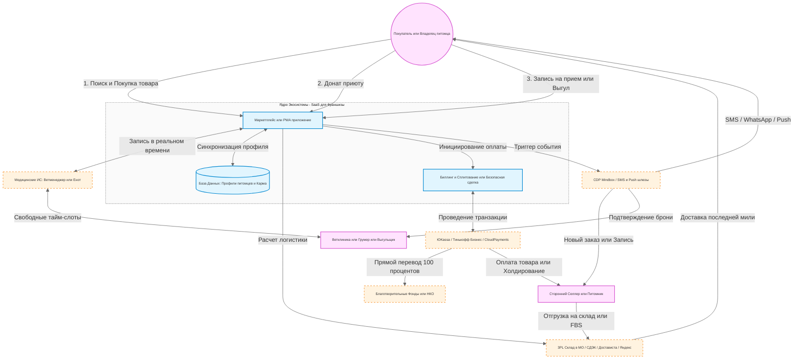

# Pet Ecosystem Platform — README.md

Этот файл README.md содержит структурированную и технически выверенную документацию для экосистемы, учитывающую изменения бизнес-модели (переход от магазина к маркетплейсу), архитектурные вызовы (SaaS под франшизу) и ограничения бюджетирования.

---

# Pet Ecosystem Platform

Pet Ecosystem Platform — это масштабируемая e-commerce и сервисная экосистема для владельцев питомцев, питомников, ветеринарных клиник и специалистов по уходу. Архитектура платформы изначально спроектирована как SaaS-решение, готовое к последующей упаковке во франшизу и экспансии в новые регионы.

Проект решает проблему разрозненности зооуслуг, объединяя товарный маркетплейс, агрегатор проверенных питомников, онлайн-запись в клиники и шеринг-экономику (выгул, груминг) в единое PWA-приложение.

---

## Навигация по документации
* [Техническая архитектура системы](#техническая-архитектура-системы)
* [Дорожная карта разработки (24 месяца)](#дорожная-карта-разработки-24-месяца)
* [Спецификация ключевых модулей](#спецификация-ключевых-модулей)
* [Юридические и финансовые ограничения](#юридические-и-финансовые-ограничения)
* [Логистическая инфраструктура](#логистическая-инфраструктура)
* [Первоочередной план действий](#первоочередной-план-действий)

---

## Техническая архитектура системы

Платформа представляет собой распределенное облачное приложение, взаимодействующее с внешними логистическими, финансовыми и медицинскими сервисами по API.

### Схема взаимодействия компонентов (High-Level Architecture)

---

## Дорожная карта разработки (24 месяца)

| Этап | Временной отрезок | Основной фокус | Ключевой функционал |
| :--- | :--- | :--- | :--- |
| **Этап 1** | 0 – 3 месяца | Запуск e-commerce ядра и логистики в ЦФО | MVP, поиск Elasticsearch, SMS-авторизация, интеграция с 3PL-складами. |
| **Этап 2** | 3 – 6 месяцев | Запуск модели Маркетплейса и Донатов | Кабинет селлера, виджет благотворительности, запуск агрегатора питомников. |
| **Этап 3** | 6 – 12 месяцев | Сервисная вертикаль «Ветклиники» | Интеграция по API с МИС (Ветменеджер, Енот) для бронирования тайм-слотов. |
| **Этап 4** | 12 – 18 месяцев | Шеринг-экономика (Выгул, Груминг) | Выпуск мобильного PWA, безопасная сделка (холдирование), верификация паспортов. |
| **Этап 5** | 18 – 24 месяца | Финализация под франшизу | Упаковка платформы в SaaS-решение, разделение прав доступа для франчайзи. |

---

## Спецификация ключевых модулей

### 1. Система лояльности и геймификации
* **Механика:** Когортная система распределения пользователей. Баллы начисляются за покупки, донаты приютам и запись к ветеринарам.
* **Кросс-маркетинг:** Возможность тратить накопленные баллы внутри партнерской сети (например, скидка на груминг за покупку корма).

### 2. Омниканальная система уведомлений
* **Технологический стек:** CRM/CDP-платформа класса Mindbox.
* **Приоритеты каналов:**
  * *Транзакционные события (Заказ, Запись к врачу):* SMS / WhatsApp шлюзы (гарантированная доставка).
  * *Маркетинговые события (Акции, Брошенная корзина):* Мобильные Push-уведомления и Email (минимизация стоимости рассылок).

### 3. Умный поиск и рекомендации
* **Поиск:** Базируется на Elasticsearch / MeliSearch. Поддерживает автоисправление опечаток и синонимы.
* **Персонализация:** При регистрации создается *Профиль питомца* (например: "Собака, Корги, 2 года"). Алгоритм автоматически адаптирует главную страницу, скрывая нерелевантные категории (товары для кошек) и предлагая специфические товары (корма для средних пород).

---

## Юридические и финансовые ограничения

### Трансформация продажи животных (Пункт 3)
* **Проблема:** Прямая дистанционная продажа породистых животных нарушает законодательство о защите животных во многих юрисдикциях. Живых существ нельзя доставлять стандартными курьерскими службами.
* **Решение:** Раздел функционирует строго как **Агрегатор проверенных питомников** (витрина объявлений). Сделка, ветеринарный осмотр и передача животного происходят очно с подписанием договора купли-продажи.

### Финансовый сплитинг и Донаты
* **Маркетплейс:** Архитектура биллинга (ЮKassa / Тинькофф Бизнес) должна поддерживать автоматическое сплитование платежей между вендорами.
* **Благотворительность:** Во избежание налоговых рисков прямые сборы на расчетный счет платформы запрещены. Интегрируется специализированный виджет (CloudPayments Solutions / «Нужна помощь»), переводящий средства напрямую на счета НКО.

---

## Логистическая инфраструктура

### Преодоление гео-разрыва (ДВ -> Центральная Россия)
* **Проблема:** Доставка тяжелых зоотоваров и кормов со складов Дальнего Востока в Центральную Россию экономически нерентабельна (высокая стоимость авиа/жд тарифов). Действующая база ДВ в 1500 человек не является целевой для старта в ЦФО.
* **Решение:** 
  1. Полная интеграция с подмосковными складами по модели **3PL-логистики** для собственных остатков.
  2. Поддержка работы сторонних селлеров по схемам **FBS / Drop-shipping** (продажи со складов партнеров).
  3. Расчет зон доставки через API СДЭК, Яндекс.Доставка и Достависта.

---

## Первоочередной план действий

Для минимизации кассовых разрывов и удержания плотного бюджета разработки (15–20 млн руб., из которых до 50% должно быть зарезервировано на маркетинг в ЦФО), работы начинаются со следующих шагов:

1. **Проектирование ИТ-архитектуры:** Привлечение независимого *Solution Architect* для создания финальной схемы БД маркетплейса до подписания договора с командой разработки.
2. **Юридический комплаенс:** Подготовка пакета документов: пользовательское соглашение, оферта для селлеров, соглашение о разделении ответственности для агрегатора питомников и клиник.
3. **Логистический консалтинг:** Заключение преддоговора с 3PL-оператором в Московской области для точного просчета юнит-экономики «последней мили».

---
*Разработано в соответствии со стандартами корпоративного ИТ-проектирования. 2026г.*
